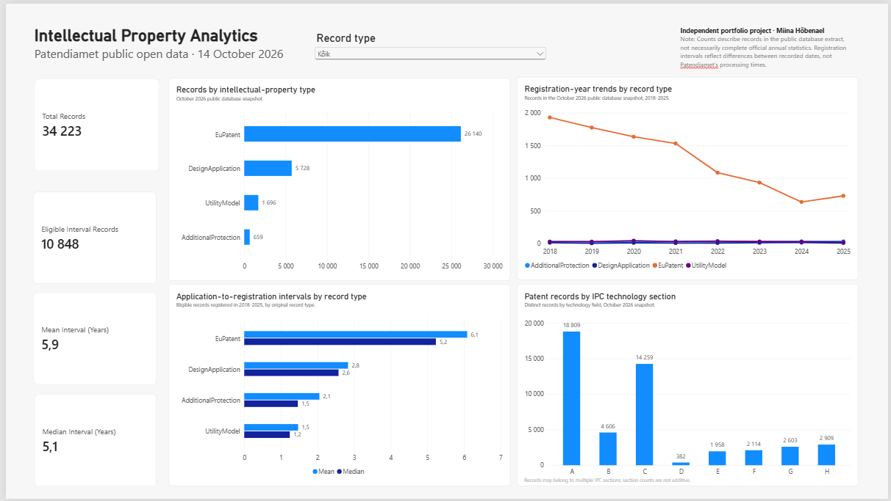

# Patendiamet open-data analytics

**Independent portfolio project | SQL · MariaDB · Python/pandas · Power BI**  
**Data snapshot:** 14 October 2026

This project explores the quality, structure and analytical value of records in Patendiamet's public **"Leiutiste MYSQL"** database extract. It combines SQL data-quality checks, Python data preparation and an interactive Power BI dashboard to turn administrative records into interpretable indicators.

The analysis uses the *Leiutiste MYSQL* extract only; it does **not** cover Patendiamet's separate *Kaubamärkide ja TD MYSQL* extract.

## Dashboard



[Power BI report (.pbix)](powerbi/patendiamet_dashboard.pbix) — open in Power BI Desktop.

The dashboard includes a record-type filter and four charts: records by source-system type, registration-year trends (2018–2025), application-to-registration date intervals, and International Patent Classification (IPC) sections.

| Dashboard indicator | All record types |
|---|---:|
| Records in the extract | 34,223 |
| Records eligible for interval analysis | 10,848 |
| Mean recorded date interval | 5.9 years |
| Median recorded date interval | 5.1 years |

> **Interpretation:** These counts describe records in a public database snapshot, **not necessarily complete official annual statistics**. Date intervals measure the difference between recorded application and registration dates; **they do not measure Patendiamet's processing times**.

## Data and workflow

**Source:** [Patendiamet public open data](https://leiutised.epa.ee/avalik/openData), *Leiutiste MYSQL*, downloaded 14 October 2026.

The extract was imported into a local MariaDB database (`patendiamet_analytics`). The main `patent` table contains **34,223 records and 41 columns**.

```text
Patendiamet SQL dump (Leiutiste MYSQL)
    → MariaDB
    → SQL profiling, quality checks and analytical queries
    → Python/pandas validation and transformation
    → CSV datasets
    → Power BI data model, DAX measures and dashboard
```

The original database records are not modified by the Python pipeline. Raw SQL dumps are not included in this repository.

### What the analysis found

- **Data quality depends on record type and status.** Missing classification or registration-date fields may reflect differences in administrative processes rather than data-entry errors. There are 2,966 records without a registration date.
- **Some cases need domain validation.** One `EuPatent` record has a registration number but no registration date. Nine `EuPatent` records have a recorded registration date of 16 November 2026, later than the snapshot date; these are flagged for investigation, not labelled as confirmed errors.
- **IPC classifications require normalization.** Comma-separated `ipc_class` values were expanded into **131,929 unique record–IPC assignments** covering 33,629 records; 63 repeated assignments were removed.
- **Registration-date intervals differ by record type.** SQL results were reproduced in Python, including the 10,848 eligible observations. The lower medians suggest that longer observations influence the means.

| Original record-type code | Mean interval | Median interval |
|---|---:|---:|
| `EuPatent` | 6.1 years | 5.2 years |
| `DesignApplication` | 2.8 years | 2.6 years |
| `AdditionalProtection` | 2.1 years | 1.5 years |
| `UtilityModel` | 1.5 years | 1.2 years |

For this table, records must have valid application and registration dates and a registration year from **2018 to 2025**. Intervals are calculated from recorded calendar dates, not from verified administrative processing durations.

Original record-type codes are retained because their precise business definitions require confirmation against source-system documentation.

For IPC charts, a record is counted once *within* each IPC section, but may belong to several sections. Therefore, section counts cannot be added together to obtain the number of distinct records.

## Repository guide

| Location | Contents |
|---|---|
| [`sql/data_quality.sql`](sql/data_quality.sql) | Data profiling and consistency checks |
| [`sql/analysis.sql`](sql/analysis.sql) | Analytical SQL queries |
| [`python/extract_transform.py`](python/extract_transform.py) | Read-only extraction, validation, date-interval calculation and IPC normalization |
| [`requirements.txt`](requirements.txt) | Python dependencies |
| [`powerbi/patendiamet_dashboard.pbix`](powerbi/patendiamet_dashboard.pbix) | Interactive Power BI report and DAX measures |
| [`docs/patendiamet_dashboard.png`](docs/patendiamet_dashboard.png) | Dashboard screenshot |

The Python script generates three files under `data/processed/`:

- `patent_records.csv` — source records with derived year and interval fields;
- `ipc_codes.csv` — normalized, deduplicated record–IPC assignments;
- `registration_intervals_summary.csv` — reference statistics by record type.

In Power BI, `patent_records` is related one-to-many to `ipc_codes` through the record ID, with single-direction filtering. The summary table remains disconnected for comparison with DAX measures calculated dynamically from record-level data.

## Reproducing the analysis

**Prerequisites:** Python 3.13, MariaDB, Power BI Desktop (to open the report), and the public *Leiutiste MYSQL* SQL extract.

1. Download the extract from the [source page](https://leiutised.epa.ee/avalik/openData) and import it into a local MariaDB database named `patendiamet_analytics`.
2. Inspect or execute `sql/data_quality.sql` and `sql/analysis.sql` using a MariaDB-compatible SQL client.
3. In Git Bash, from the repository root, run:

   ```bash
   python -m venv .venv
   source .venv/Scripts/activate
   python -m pip install -r requirements.txt
   python python/extract_transform.py
   ```

4. Open `powerbi/patendiamet_dashboard.pbix` in Power BI Desktop. To refresh the report on another computer, update its Power Query CSV paths to the files generated in `data/processed/`.

The Python script prompts for the MariaDB password rather than storing it in the source code. The extraction is read-only with respect to the database.

**Reproducibility note:** The results shown here refer to the **14 October 2026 snapshot**. A newer download may contain different records and produce different figures.

## Limitations

- The public extract may not contain every application or event included in official annual statistics. Record counts should not be used as direct measures of filing activity or innovation without further validation.
- Application dates and registration dates refer to different events and cohorts. Recent application years may be underrepresented in the extract.
- Different record types follow different administrative processes. Source-system type and status labels should not be reinterpreted without checking their definitions.
- Missing values and unusual dates are **flags for investigation**, not automatically data-quality failures.
- IPC sections overlap: one record may appear in multiple technology fields.

This is an **independent portfolio project**, not an official Patendiamet publication or an assessment of its operational performance.

## Future improvements

- Automate retrieval of updated open-data extracts and repeatable database refreshes.
- Add automated data-quality checks to the refresh workflow.
- Explore external API enrichment (for example, selected patent information through EPO OPS), subject to data access and licensing requirements.
